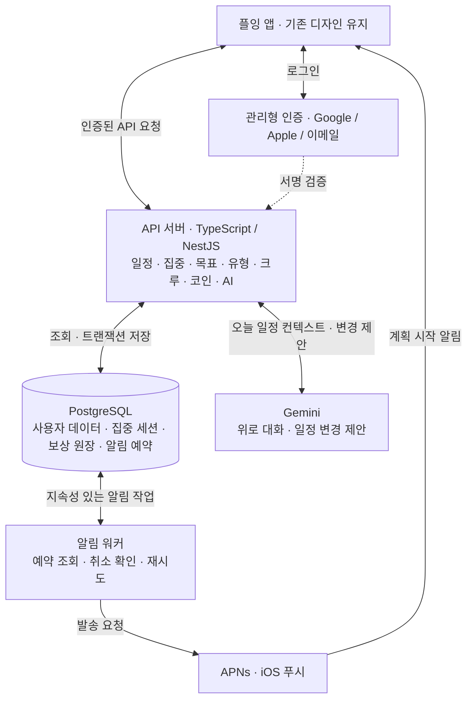
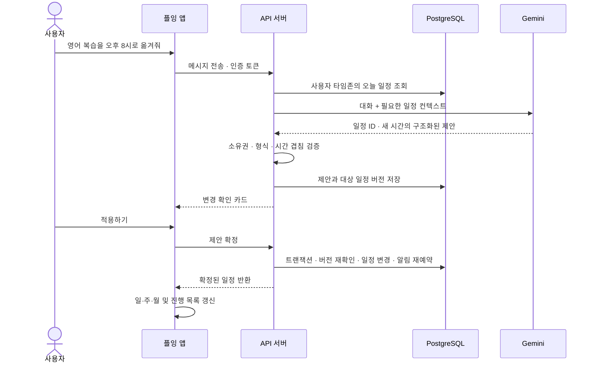
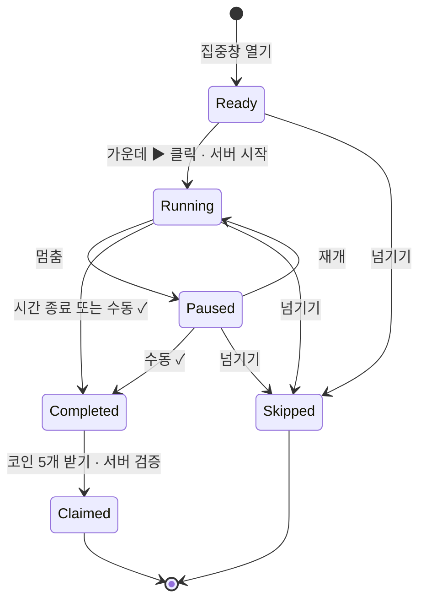

# 플잉 백엔드 아키텍처 제안

작성: 2026-11-17. 사용자 요구와 현행 HTML에 맞춘 **구현 전 설계안**이다. 코드를 배포하거나 서버를 생성한 상태는 아니다. 프론트엔드 앱 플랫폼·호스팅·세부 라이브러리는 미확정이다.

[전체 구조 그림](ARCHITECTURE.svg) · [Mermaid 원본](ARCHITECTURE.mmd) · [현재 구현](CURRENT_STATE.md) · [데이터/API 인수인계](BACKEND_HANDOFF.md)

## 1. 추천 구조

초기에는 하나의 코드베이스에 API 서버와 알림 워커를 만들고 별도 프로세스로 실행한다. 데이터는 PostgreSQL에 저장한다. NestJS 모듈로 기능을 구분하되 동일 데이터베이스의 트랜잭션을 사용할 수 있게 유지한다.



| 구성 | 제안 | 맡는 일 |
| --- | --- | --- |
| 앱 | 현재 HTML을 디자인 기준으로 앱 플랫폼에 연결 | 화면·입력·타이머 표시·위로 인사·마스코트 애니메이션 |
| 인증 | 관리형 인증, 예: Supabase Auth | Google/Apple/이메일 로그인, 토큰 발급·갱신 |
| API | TypeScript + NestJS | 사용자 권한, 검증, 모든 기능의 데이터 변경 |
| DB | 관리형 PostgreSQL | 일정·목표·크루·세션·원장·알림 예약의 영구 저장 |
| Worker | API와 같은 코드베이스, 별도 실행 프로세스 | 기한이 된 알림 작업 처리·재시도 |
| AI | Gemini, 서버에서만 호출 | 따뜻한 공부 대화, 구조화된 일정 변경 제안 |
| iOS 푸시 | APNs 어댑터 | 기기 토큰으로 알림 발송 |

사용자가 “ansp”라고 표현했던 알림 서비스는 APNs로 잠정 해석한 상태다. iOS 앱을 전제로 그렸다. 웹/PWA·Android도 만들면 해당 전송 어댑터를 추가하고 기기 등록 방식을 결정한다. Supabase Auth와 NestJS는 추천 선택지이며 기존 저장소 스택이 정해지면 그 구조에 맞출 수 있다. Redis는 초기 필수 구성으로 두지 않는다.

## 2. API 내부 모듈과 데이터 소유

| 모듈 | 주요 테이블 | 책임 |
| --- | --- | --- |
| Auth / Profile | profiles | 인증 토큰 검증, 사용자·타임존 |
| Plans | plans, plan_completions | 일정 생성/변경/삭제, 시간 겹침, 완료·취소 |
| Focus | focus_sessions | 대기·시작·멈춤·재개·완료·넘김, 재접속 복원 |
| Rewards | reward_ledger | 5코인 지급, 멱등 처리, 잔액 조회 |
| Goals | goals | 개인 목표, 공동 목표와 연결 |
| Survey | survey_responses, study_type_results | 답변 저장, 버전이 있는 4유형 규칙 |
| Crews | crews, crew_members, crew_invites | 생성·초대·가입·탈퇴·권한 |
| Chat | conversations, messages, action_proposals | Gemini 호출, 사용자 확인이 필요한 변경 제안 |
| Notifications | user_preferences, devices, notification_jobs, delivery_attempts | 선호·토큰, 예약·취소·발송 결과 |

채팅 메시지 보관 기간과 삭제 정책은 미정이다. 최초 구현 전에 정하고 사용자의 대화 저장 선택에 반영한다. 기존 고2 sample 일정과 로컬 코인 원장은 실사용 기록으로 자동 신뢰하지 않는다.

모든 사용자 데이터 요청은 토큰에서 얻은 user_id를 기준으로 조회한다. 클라이언트가 보낸 user_id만으로 소유권을 판단하지 않는다. 관리자 DB 연결 권한이나 AI 키는 앱에 포함하지 않는다. 관리형 DB의 브라우저 직접 접근을 쓰지 않는 기본안에서는 앱 데이터 접근을 API로 모으고, DB 접근 정책도 함께 설정한다.

## 3. 핵심 흐름 A — AI가 일정을 바꾸기



사용자가 확인하기 전에 확정 저장하지 않는다. 확인 버튼을 누르는 동안 다른 기기에서 일정이 바뀌면 버전 불일치를 반환하고 새 제안을 보여준다. Gemini 출력은 제안 데이터이며 서버 코드만 허용된 변경을 실행한다. 모델 호출 실패 시 일정 원본은 유지한다.

유형 사분면은 현재 설문 규칙을 서버로 옮겨 일관되게 계산하면 된다. 사분면 표시에 추가 LLM 호출은 필요하지 않다. 따뜻한 말투는 우선 서버의 시스템 지침·예시 대화로 구성하고 모델 학습 여부는 별도 결정한다.

## 4. 핵심 흐름 B — 수동 시작과 5코인



- 앱 화면 진입으로 타이머를 실행하지 않는다. 서버 세션은 READY, ▶ 요청을 받으면 RUNNING이 된다.
- 서버 시작 시각·일시정지 누적시간을 기준으로 남은 시간을 복원한다. 클라이언트는 초마다 화면만 갱신하며 초마다 서버에 쓸 필요가 없다.
- 실행 중 앱을 닫아도 경과 시간은 흐르고, PAUSED일 때만 멈추는 안을 추천한다. 현재 HTML의 재진입 방식과 가깝다. 실제 제품 정책으로 확정한다.
- 서버가 완료 가능 상태와 해당 계획 소유권을 확인한 뒤 완료 기록을 저장한다. 클라이언트가 보낸 “0초 남음” 자체를 근거로 삼지 않는다.
- 코인 수령은 별도 요청이다. 완료와 수령을 분리해도 동일 계획 보상 키와 DB UNIQUE 제약으로 한 번만 지급한다. 지급·잔액 캐시 갱신은 한 트랜잭션에서 처리한다. 재요청은 기존 지급 결과를 반환한다.
- 초기 잔액 0, 한 계획당 +5. 완료 취소 후 재완료해도 보상 유일 키를 지우지 않는다. 같은 계정의 여러 세션/기기에서 수령해도 중복 지급하지 않는다.
- 현재 HTML은 조기 ✓ 완료도 보상한다. 설계안도 이 흐름을 유지해 표시했으며, 조기 완료 보상 제한 여부는 개발 전 제품 정책으로 결정한다.

DB 유일 키 예: reward_ledger(user_id, plan_id, reason). 미래 반복 일정이 생기면 plan_id가 매일의 일정 인스턴스를 나타내도록 하거나 occurrence_id를 보상 키에 포함한다.

## 5. 핵심 흐름 C — 예약 알림

API가 일정을 저장하는 트랜잭션 안에서 notification_jobs도 생성·수정한다. 워커는 DB의 도래한 작업을 잠금으로 가져오고, 현재 일정 버전·완료 상태·알림 선호·유효 토큰을 확인한 뒤 발송한다.

작업 필드 예: id, plan_id, plan_version, device_id, kind, due_at, status, attempt_count, next_attempt_at, lock_until. `due_at`과 상태로 조회할 인덱스를 둔다. 기한 만료 잠금은 다른 워커가 재시도할 수 있게 한다.

1. 계획 저장/시간 변경 → 새 버전 기준 정시·미리 알림 작업 저장.
2. 일정 삭제/완료/알림 끄기 → 아직 보내지 않은 작업 취소.
3. 워커가 기한 도래 작업을 선점 → 최신 상태 재검증 → APNs 전송.
4. 결과/재시도 시각 기록, 잘못되었거나 만료된 기기 토큰은 사용 중지.

외부 푸시 전송과 DB 기록은 하나의 DB 트랜잭션으로 묶을 수 없다. 전송 성공 후 기록 전 장애가 나면 재시도될 수 있으므로 논리 작업 키·발송 기록·앱 이벤트 ID로 중복 영향을 줄인다. 이미 발송된 알림을 일정 변경 뒤 회수할 수 있다고 가정하지 않는다. APNs는 수신 시각을 엄격히 보장하는 타이머가 아니며, 앱의 현재 일정/타이머 판단은 서버 데이터로 한다.

잠금화면 디자인은 푸시 알림 카드와 별도 위젯/Live Activity 구현으로 나눈다. 기존 lockscreen HTML은 화면 참고용이다. 네이티브 방식은 앱 플랫폼 결정 후 설계한다.

## 6. 데이터 설계 원칙

- API는 ISO 8601의 시간대 포함 시각을 사용한다. DB는 시작/끝/알림 기한을 UTC 기준 timestamptz로 보관하고, 사용자 time_zone(초기 Asia/Seoul)을 별도로 가진다. 날짜별 조회와 “오늘”은 사용자 타임존에서 계산한다.
- 일정 범위는 `[start_at, end_at)`로 처리해 10:00–11:00 다음에 11:00 일정을 허용한다. 끝>시작을 DB와 API에서 검증한다.
- 현재 제품 정책인 같은 사용자 일정 겹침 거부는 PostgreSQL 범위 EXCLUDE 제약 등 동시 요청에도 유지되는 방식으로 구현한다. 필요한 확장/인덱스는 호스팅 환경에서 확인한다. 완료 상태와 일정 시간 점유 정책도 일관되게 둔다.
- 색상 HEX는 중복 허용이다. 색상 유일 제약을 두지 않는다.
- 크루 데이터와 개인 일정은 별도다. 공동 목표를 개인 목표에 담으면 연결 ID로 중복을 막으며, 내 완료 표시를 다른 멤버 완료로 반영하지 않는다.
- 타이머 상태 전환과 제안 확정에 버전/행 잠금을 적용한다. 동시에 온 시작·재개·완료 요청을 중복 처리하지 않는다.

## 7. 코드 구조와 배포 제안

```text
backend/
  apps/api/             # HTTP API · Gemini 스트림 응답
  apps/worker/          # DB 알림 작업 소비 · APNs 전송
  modules/
    auth/ profiles/ plans/ focus/ rewards/
    goals/ survey/ crews/ chat/ notifications/
  database/             # 스키마 · 마이그레이션
  tests/                # 권한 · 지급 멱등성 · 일정 충돌 · 상태 전환
```

API와 워커는 같은 버전의 컨테이너/코드에서 서로 다른 시작 명령으로 실행한다. DB는 별도 관리형 PostgreSQL로 두고 백업·마이그레이션·복구 방식을 준비한다. 인증 서비스와 같은 공급자의 PostgreSQL을 쓰더라도 데이터베이스는 하나다.

환경 변수: DB 연결, 인증 issuer/JWKS, Gemini 키, APNs 키·team/topic 식별자. 값은 서버 비밀 저장소에 두고 예시 파일에는 이름만 기록한다. 상태 확인 엔드포인트, 요청 ID, 알림 실패율·대기 시간, AI 실패/사용량, 지급 충돌을 관찰한다. 로그에는 전체 공부 고민 대화나 비밀키를 기본 출력하지 않는다.

## 8. 구현 순서

1. 인증 + PostgreSQL + 일정 CRUD/동시 충돌 방지.
2. 집중 상태 복원 + 멱등 보상 원장 + 기존 축하 UI 연결.
3. 목표·설문·사분면 + 사용자 설정 저장.
4. Gemini 대화·일정 제안·확정 적용.
5. 크루 실제 초대·가입 + 알림 워커·기기 토큰 + 네이티브 알림 검증.

## 9. 참고한 공식 자료

다음 링크는 사용 기술의 동작 근거이며 위 구성과 순서는 플잉에 대한 설계 제안이다. 확인일 2026-11-17.

- [NestJS: TypeScript/Node.js 앱 구성](https://docs.nestjs.com/first-steps)
- [Supabase Auth: 인증 제공자](https://supabase.com/docs/guides/auth)
- [Supabase: JWT 서명 키](https://supabase.com/docs/guides/auth/signing-keys)
- [PostgreSQL: UNIQUE·EXCLUDE·관계 제약](https://www.postgresql.org/docs/current/ddl-constraints.html)
- [Gemini API: Function calling](https://ai.google.dev/gemini-api/docs/function-calling)
- [Apple: APNs 발송 요청](https://developer.apple.com/documentation/usernotifications/sending-notification-requests-to-apns)
