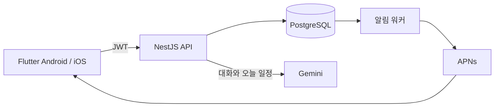

# 현재 서버 구조

Flutter 앱 → NestJS API → PostgreSQL입니다. 집중·코인·일정·목표·유형·크루·AI를 하나의 API 안에서 모듈로 나눴고, 알림 소비자는 같은 코드베이스의 별도 프로세스입니다.

일정 수정과 알림 예약은 같은 트랜잭션에서 처리합니다. 집중 전환은 사용자·계획·세션 잠금을 일관된 순서로 잡습니다. 보상은 원장의 유일 키로 한 번만 기록합니다.

Gemini는 DB를 직접 수정하지 않습니다. 구조화된 제안을 저장하고 사용자가 적용할 때 소유권·계획 버전·시간 충돌을 검사합니다.

현재 앱은 이메일 로그인입니다. 외부 로그인은 Supabase의 issuer/JWKS 검증 경계만 있습니다. 네이티브 소셜 로그인·실제 푸시 토큰 등록·Android FCM은 미구현입니다.

로직 테스트는 PGlite에서 수행했습니다. 실제 PostgreSQL 다중 연결, HTTP와 기기 실행은 추가 검증해야 합니다.
